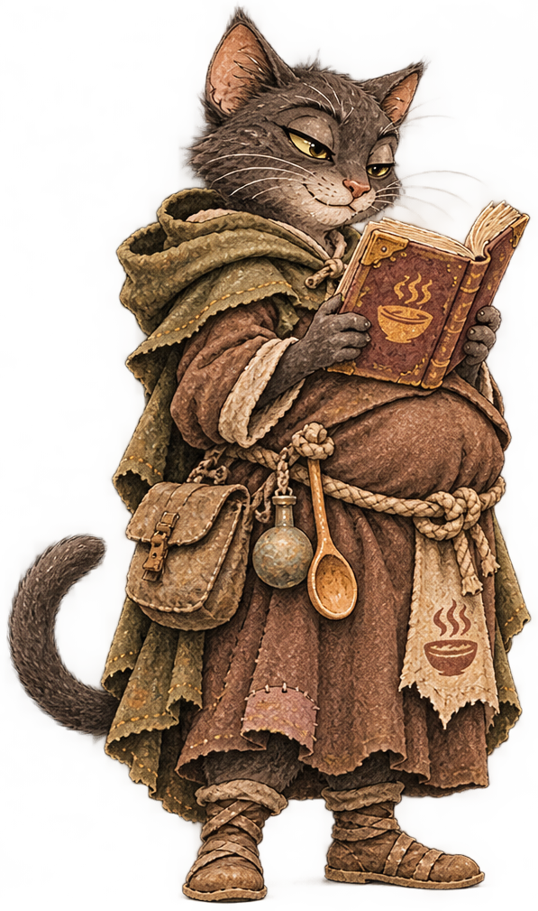

# Marée de Nuit

## Description et personnalité

Moine de la Faim Rassasiée, érudit, observateur et réfléchi, avec une expression légèrement ironique. Ses connaissances aident à interpréter la magie.

## Histoire personnelle

Origine non renseignée. Appartient à l’ordre de la Faim Rassasiée.

## Évolution pendant la campagne

- **CH_03** : Conseille à Kali de reconvertir son bateau.
- **CH_04** : Reçoit les missions du père Bombance ; enquête chez Gargantua et prélève un échantillon.
- **Suite — souvenir à recouper** : Rôle important dans le concours culinaire et la quête de la Marmite.

## Références visuelles

## Description graphique

Chalupestre moine de la Faim Rassasiée, pelage gris sombre, yeux jaune-vert, moustaches, silhouette ronde avec gros petit bedon bien visible sous la robe. Robe brune, capuche olive, corde à la taille, besace, cuillère, livre et motif de bol fumant selon la référence. Expression attentive, réfléchie et légèrement ironique. Ne pas l’amincir.

## Prompt graphique de référence

Illustration originale de fantasy picaresque italienne, encre fine expressive et aquarelle texturée, rendu artisanal semi-réaliste, détails de matières, vêtements usés, couleurs sourdes (encre #30261F, bordeaux #843A32, olive #546047, or ancien #AC8949). Respecter strictement la planche validée jointe : visage, silhouette, costume et accessoires. Portrait en pied, personnage isolé, fond réellement transparent, sans décor, texte ni cadre. Ne pas embellir ou moderniser le personnage. Chalupestre moine de la Faim Rassasiée, pelage gris sombre, yeux jaune-vert, moustaches, silhouette ronde avec gros petit bedon bien visible sous la robe. Robe brune, capuche olive, corde à la taille, besace, cuillère, livre et motif de bol fumant selon la référence. Expression attentive, réfléchie et légèrement ironique. Ne pas l’amincir.

## Variantes et continuité

Conserver la silhouette ronde et les accessoires de la référence. Aucune variante validée renseignée.

## Sources et validation

- Référentiel narratif : [RECIT_02_Personnages.md](../../Narration/RECIT_02_Personnages.md).
- Prompt récupéré sur GitHub : `01_Referentiel/Graphisme/prompts/pj/PJ_MAREE_DE_NUIT_PROMPT.txt` (emplacement au 25/11/2026).
- Bible graphique GRAPH_02, V1.0, 25/11/2026.
- Fiche de travail à valider ; les événements ultérieurs au chapitre IV restent provisoires. Les identifiants des PNJ hors de cette série sont proposés, à créer ou confirmer.
