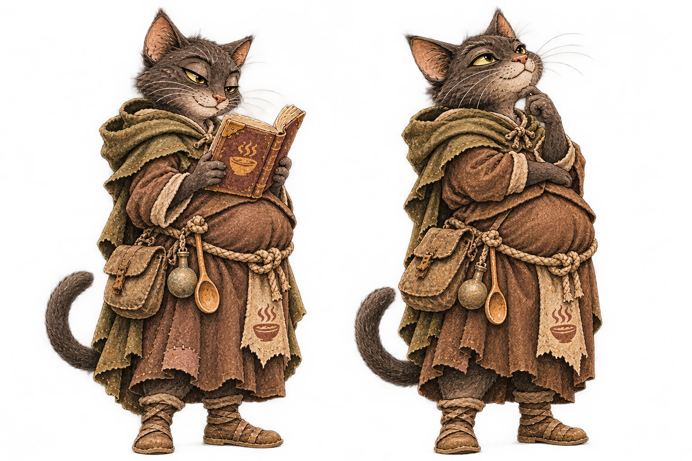

# Marée de Nuit

## Description et personnalité

Moine de la Faim Rassasiée, érudit, observateur et réfléchi, avec une expression légèrement ironique. Ses connaissances aident à interpréter la magie ; son sens de l'observation et son ingéniosité lui permettent également de trouver des solutions pratiques, comme lors de la rencontre avec le flûtiste.

## Histoire personnelle

Origine non renseignée. Appartient à l’ordre de la Faim Rassasiée.

## Évolution pendant la campagne

- **CH_03** : Conseille à Kali de reconvertir son bateau.
- **CH_04** : Reçoit les missions du père Bombance ; enquête chez Gargantua et prélève un échantillon.
- **CH_05 — Retour à l'Académie** : Les gardes recherchent les Canailles pour destruction de marionnette, après la chute au sol d'une marionnette que Marée de Nuit avait fait tomber de la péniche. Devant l'échec du déguisement des faux professeurs, il propose de faire appeler Mustrum Ridculouis, dit Louis, qui leur permet d'entrer.
- **CH_05 — Recherches universitaires** : Avec Psodia, il est l'un des deux membres du groupe sachant lire. Lorsque Louis identifie les mystérieux guerriers comme des elfes, Marée de Nuit se remémore le récit *Du dit des nains et des elfes*, notamment leur exil par les fées.
- **CH_05 — La résurrection en milieu bovin** : À la demande du guiscard Destin, remplace un professeur absent et dispense avec succès un cours magistral sur la question : « Si on lance un sort de résurrection à un guerrier vêtu d'une veste en cuir, revient-il à la vie DANS une vache ? » Le contenu exact de sa démonstration n'est pas retrouvé.
- **CH_05 — Les geôles de Sibara** : Après plusieurs tentatives infructueuses pour dissiper la bulle de silence du Malebranche flûtiste, trouve le moyen de communiquer avec lui par des dessins tracés dans la poussière du sol. Cette conversation éclaire l'exode des ratons de Pandosia.
- **CH_05 — Pandosia** : Participe à l'expédition et à la libération de Quenotte avec les Canailles. La répartition exacte des rôles lors du combat et du polissage n'est pas établie.
- **CH_05 — Croc Chef** : Apprend qu'un concours culinaire est organisé à Sibara, avec une marmite magique comme premier prix. S'engage à y participer, dans le cadre de sa quête pour le père Bombance. L'identité du prix n'est pas encore confirmée.
- **CH_06 — Suite à documenter** : Concours culinaire et quête de la marmite de Saint Glaude.

## Références visuelles

## Description graphique

Chalupestre moine de la Faim Rassasiée, pelage gris sombre, yeux jaune-vert, moustaches, silhouette ronde avec gros petit bedon bien visible sous la robe. Robe brune, capuche olive, corde à la taille, besace, cuillère, livre et motif de bol fumant selon la référence. Expression attentive, réfléchie et légèrement ironique. Ne pas l’amincir.

## Prompt graphique de référence

Illustration originale de fantasy picaresque italienne, encre fine expressive et aquarelle texturée, rendu artisanal semi-réaliste, détails de matières, vêtements usés, couleurs sourdes (encre #30261F, bordeaux #843A32, olive #546047, or ancien #AC8949). Respecter strictement la planche validée jointe : visage, silhouette, costume et accessoires. Portrait en pied, personnage isolé, fond réellement transparent, sans décor, texte ni cadre. Ne pas embellir ou moderniser le personnage. Chalupestre moine de la Faim Rassasiée, pelage gris sombre, yeux jaune-vert, moustaches, silhouette ronde avec gros petit bedon bien visible sous la robe. Robe brune, capuche olive, corde à la taille, besace, cuillère, livre et motif de bol fumant selon la référence. Expression attentive, réfléchie et légèrement ironique. Ne pas l’amincir.

## Variantes et continuité

Conserver la silhouette ronde et les accessoires de la référence. Aucune nouvelle variante graphique validée.

- **Déguisement universitaire (CH_05)** : robe de mage et fausse barbe, en conservant ses traits reconnaissables et son petit bedon ; variante à valider.
- **Cours magistral (CH_05)** : posture de professeur assuré ; éventuels supports pédagogiques à définir sans prétendre reconstituer sa démonstration exacte.
- **Croc Chef** : ne pas fixer de tenue de cuisinier ni d'accessoires supplémentaires avant la reconstitution du chapitre VI.

## Sources et validation

- Référentiel narratif : [RECIT_02_Personnages.md](../../Narration/RECIT_02_Personnages.md).
- Prompt récupéré sur GitHub : `01_Referentiel/Graphisme/prompts/pj/PJ_MAREE_DE_NUIT_PROMPT.txt` (emplacement au 25/11/2026).
- Bible graphique GRAPH_02, V1.0, 25/11/2026.
- [Chapitre V, partie 1](../../../02_Manuscrits/Trames/CH5_chapitre5_Pandosia_partie_1_trame.md) et [partie 2](../../../02_Manuscrits/Trames/CH5_chapitre_05_Pandosia_partie_2_trame.md) ; [chronologie](../../Narration/RECIT_01_Chronologie.md) ; [registre des illustrations](../../Graphisme/GRAPH_05_Prompts_CH05_Pandosia.md).
- Fiche actualisée au 25 novembre 2026, à valider ; les événements ultérieurs au chapitre V restent provisoires. Les PDF du MJ n'ont pas été relus pour cette mise à jour. Les identifiants des PNJ hors de cette série sont proposés, à créer ou confirmer.
