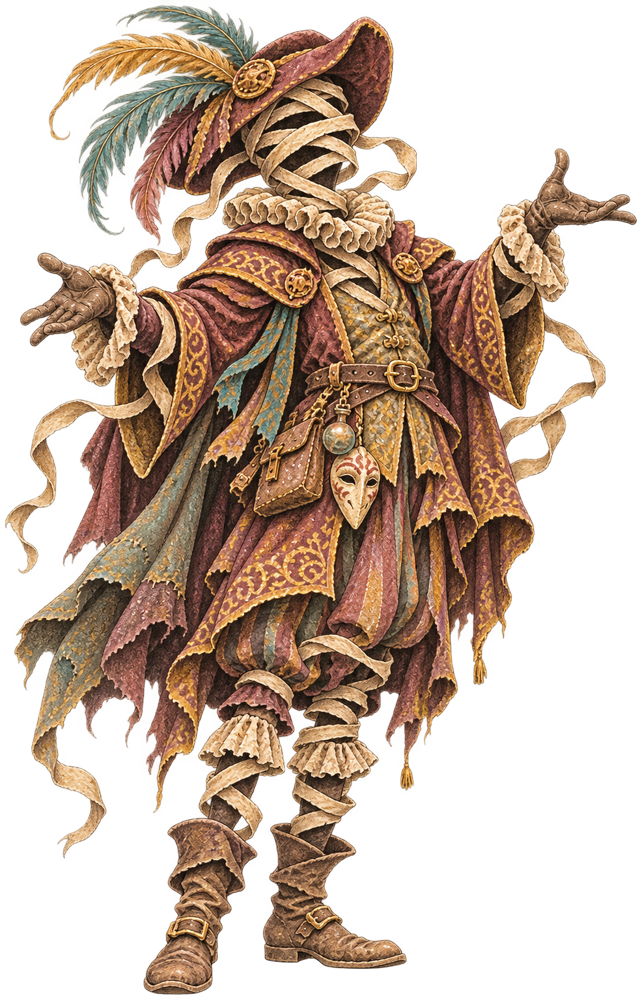
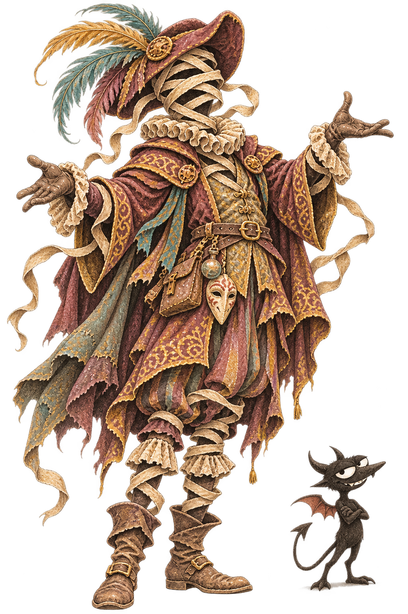

# Personne

## Description et personnalité

Théâtral, flamboyant, pratique les arts occultes. Les masques lui donnent accès aux souvenirs des personnes représentées, avec un risque de perte de soi.

## Histoire personnelle

Apparu dans une malle de vêtements de Gisela sur la péniche, qu’il considère comme Maman. Au chapitre V, après sa réparation, la péniche se réveille et communique avec lui : elle lui révèle être un Port-Trop-Loin, capable de rejoindre n'importe quel port déjà vu à condition d'atteindre 8,8 nœuds par heure grâce à la Burrichetta, qui fait office de moteur (Q517). Les modalités précises de la communication restent à établir ; aucune autre restriction du voyage n'est confirmée. Utilisations ultérieures : retour à Scanzona pour chercher Perdita, puis voyage vers l'île des enfants perdus grâce à un dessin laissé dans sa chambre ; une représentation du lieu suffit dans ce cas (Q510, Q517).

## Évolution pendant la campagne

- **CH_01** : Premier masque : Dona Vitalli. Avec Tito et Marée de Nuit, remplace les musiciens du Doux Fumet au bal pour entrer sans invitation ; ils tentent d'interpréter un ou deux airs (Q108).
- **CH_02** : Après le combat contre les grands guerriers près d'Ondine, se confectionne un masque d'elfe (leur nature ne sera explicitement identifiée que plus tard). Il s'agit du deuxième masque connu après celui de Dona Vitalli ; ses modalités exactes de fabrication et sa première utilisation ne sont pas précisées. S'oppose à la mission du pèlerinage ; Au passage au niveau 3, lors du retour sur la péniche en fin de session, son familier Truffino apparaît et annonce que Maman est en danger (Q206). La dégradation de la santé de Personne rend le sauvetage de la péniche urgent et contribue à l'abandon du pèlerinage (Q205).
- **CH_03** : Endommage la cale de La Brigantine ; les Canailles ne comprennent pas pourquoi (Q302).
- **CH_04** : Fabrique des laissez-passer ; utilise le masque de Dona Vitalli au Domaine des Vieux.
- **CH_05 — Retour à Sibara** : Surveille d'abord la cargaison de bois de vétille à bord de la péniche, puis retrouve ses compagnons. Le moment exact où il rejoint la délégation universitaire n'est pas établi.
- **CH_05 — Recherches à la bibliothèque** : Ne sachant pas lire, il se voit prêter par Louis des lunettes magiques qui lui permettent de déchiffrer les ouvrages. C'est lui qui découvre dans un livre une référence au *Liber Vetillæ* et fait ainsi avancer l'enquête sur la lignification. « Lorgnons de Gouguel » est un nom proposé pour le recueil, non une appellation canonique confirmée.
- **CH_05 — Pandosia** : Arrêté avec les Canailles après la dénonciation de Hulc, participe à l'évasion et à l'expédition souterraine. Combat les golems tandis que Psodia polit la statuette, puis participe à l'affrontement collectif contre les cinq elfes (Q515).
- **CH_05 — Le réveil de Maman** : Après le retour de Pandosia, la péniche réparée lui parle et lui révèle sa véritable nature de Port-Trop-Loin. La clique libère également Nuance, l'anguana emprisonnée dans la figure de proue, grâce à la polisseuse rapportée de Pandosia. Ne pas attribuer personnellement cette opération à Personne sans confirmation.

## Références visuelles

## Description graphique

Inexistant sans corps matériel. Visage entouré de bandelettes de tissu crème comme une momie, vide noir entre les rubans, aucune peau ni anatomie visible. Costume théâtral Renaissance bordeaux, or ancien et turquoise, chapeau à plumes, fraise, gants et bottes, masque en accessoire. Gestuelle flamboyante et expressive. Les masques acquis au fil de la campagne constituent des variantes distinctes.

## Prompt graphique de référence

Illustration originale de fantasy picaresque italienne, encre fine expressive et aquarelle texturée, rendu artisanal semi-réaliste, détails de matières, vêtements usés, couleurs sourdes (encre #30261F, bordeaux #843A32, olive #546047, or ancien #AC8949). Respecter strictement la planche validée jointe : visage, silhouette, costume et accessoires. Portrait en pied, personnage isolé, fond réellement transparent, sans décor, texte ni cadre. Ne pas embellir ou moderniser le personnage. Inexistant sans corps matériel. Visage entouré de bandelettes de tissu crème comme une momie, vide noir entre les rubans, aucune peau ni anatomie visible. Costume théâtral Renaissance bordeaux, or ancien et turquoise, chapeau à plumes, fraise, gants et bottes, masque en accessoire. Gestuelle flamboyante et expressive. Les masques acquis au fil de la campagne constituent des variantes distinctes.

## Variantes et continuité

Les masques constituent des variantes distinctes, à dater selon leur acquisition. Aucun visage anatomique dans son apparence habituelle.

- **Masque d'elfe (CH_02)** : confectionné après l'affrontement contre les grands guerriers. Variante graphique à préparer, sans introduire ce masque dans les scènes antérieures. Son aspect précis et la première scène où Personne le porte restent à documenter ; ne pas transformer le masque en visage anatomique permanent.

- **Lunettes de lecture magiques (CH_05)** : variante ponctuelle à la bibliothèque ; adapter les lunettes aux bandelettes sans ajouter de peau, d'yeux anatomiques ni de visage humain. L'objet est prêté, sa possession durable n'est pas attestée.
- **Déguisement universitaire (CH_05)** : robe de mage et fausse barbe si la scène le justifie ; sa présence au moment de l'achat des déguisements ou du contrôle à l'entrée reste incertaine.
- **Communication avec Maman (CH_05)** : privilégier une scène intime avec la péniche réparée ; ne pas matérialiser un visage sur la coque ni inventer un mode de communication. Nuance est encore en bois lors de la révélation du Port-Trop-Loin, selon l'ordre retenu dans la trame.

## Sources et validation

- Référentiel narratif : [RECIT_02_Personnages.md](../../Narration/RECIT_02_Personnages.md).
- Prompt récupéré sur GitHub : `01_Referentiel/Graphisme/prompts/pj/PJ_PERSONNE_PROMPT.txt` (emplacement au 25/11/2026).
- Bible graphique GRAPH_02, V1.0, 25/11/2026.
- [Chapitre V, partie 1](../../../02_Manuscrits/Trames/CH5_chapitre5_Pandosia_partie_1_trame.md) et [partie 2](../../../02_Manuscrits/Trames/CH5_chapitre_05_Pandosia_partie_2_trame.md) ; [chronologie](../../Narration/RECIT_01_Chronologie.md) ; [registre des illustrations](../../Graphisme/GRAPH_05_Prompts_CH05_Pandosia.md).
- Fiche actualisée au 25 novembre 2026, à valider ; les événements ultérieurs au chapitre V restent provisoires. Les PDF du MJ n'ont pas été relus pour cette mise à jour. Les identifiants des PNJ hors de cette série sont proposés, à créer ou confirmer.
