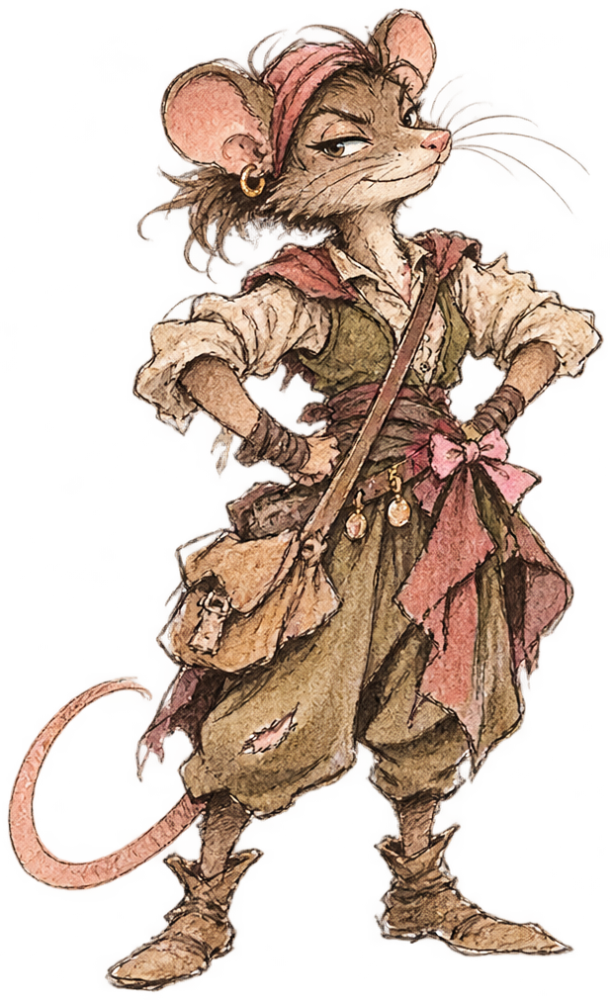
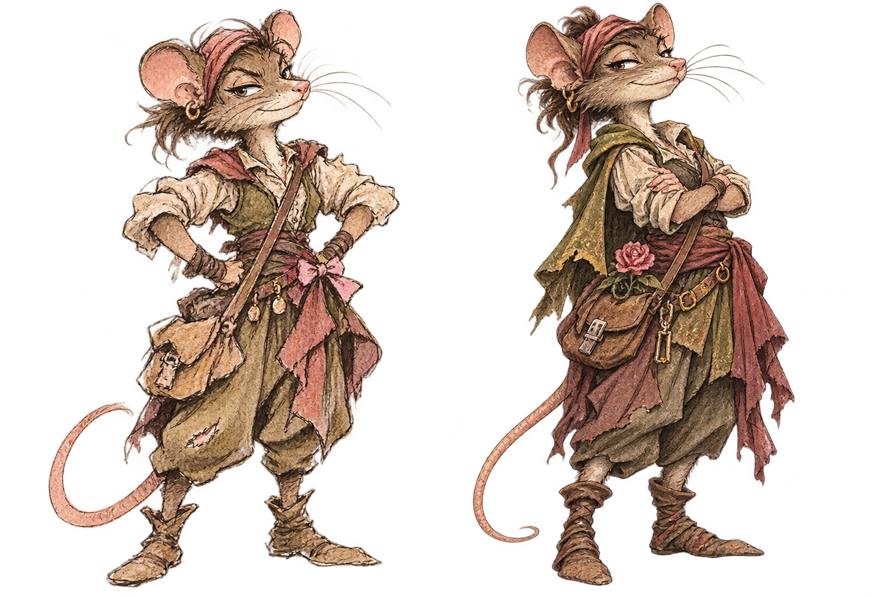
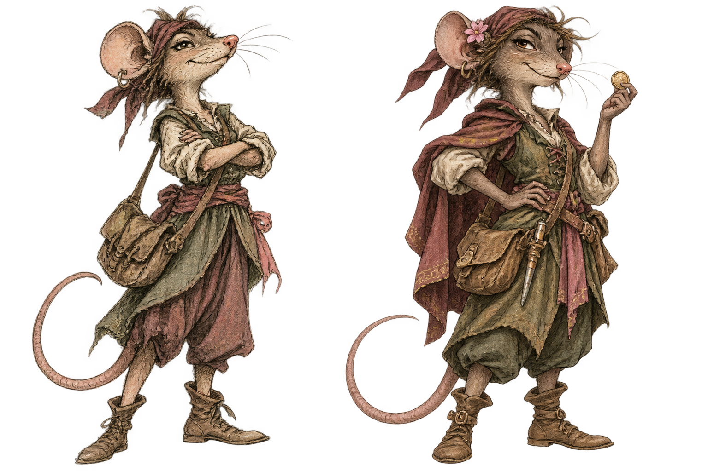

# Psodia

## Description et personnalité

Ratone roublarde, lettrée, frondeuse, malicieuse et coquette malgré une conception très personnelle de l'hygiène. Discrète et habile au crochetage, elle est très sensible aux injustices sociales et solidaire des opprimés, notamment de son peuple. Proche de Tito, elle apprécie peu l'exubérance de Personne.

## Histoire personnelle

Psodia a grandi à Sibara, à proximité de l'Académie de magie. Durant son enfance, elle a ingurgité toutes sortes de déchets arcaniques et de potions douteuses. Sa robuste constitution lui a permis de survivre ; ces expériences lui ont conféré certaines capacités magiques, mais ont également affecté considérablement sa mémoire.

Elle a notamment oublié l'emplacement de Pandosia, comme les autres ratons. Les souvenirs du sanctuaire de Quenotte lui reviennent progressivement au chapitre V. L'origine précise de cette amnésie collective ne doit pas être assimilée sans preuve aux troubles de mémoire personnels de Psodia.

## Évolution pendant la campagne

- **CH_01 — Sourcemolle** : Porte l'Agneau Unique et découvre son pouvoir d'invisibilité (Q102) ; découvre la baguette de Quenotte dans la crypte de la dix-septième pile. Lors du bal de Saint-Glinglin, Belle-Mère la Bonne Fée transforme temporairement Psodia et Sispéo en humains.
- **CH_02 — Scanzona** : Prend le parti de Cosma et des personnes démunies ; souhaite aider les habitants dans l'affaire du pèlerinage, contrairement à Personne et Sispéo. La mission est abandonnée face aux urgences et au risque d'affronter un démon puissant (Q205).
- **CH_03 — Traversée vers Sibara** : Rencontre les réfugiés ratons ; la prophétie du Kwisach des Rats fait d'elle à leurs yeux un guide vers Pandosia. Elle promet de retrouver leur cité sans en connaître encore l'emplacement.
- **CH_04 — Sibara et le bois de Bologne** : Participe aux recherches et au sauvetage du bois de vétille ; met discrètement en œuvre la potion de cochonisation lors du sabotage du Domaine des Vieux.
- **CH_05 — Pandosia et le Liber Vetillæ, première partie** : Improvise l'histoire d'une délégation de professeurs de Tarantase pour tenter d'entrer à l'Académie. Avec Marée de Nuit, elle fait partie des deux Canailles sachant lire ; participe aux recherches à la bibliothèque.
- **CH_05 — Évasion** : Tente de communiquer avec le Malebranche flûtiste, empêché de parler par une bulle de silence. Crochète la serrure de la cellule et contribue à l'évasion collective organisée par les Canailles.
- **CH_05 — Retrouvailles avec Pandosia** : Les indications d'Ondine réveillent ses souvenirs du sanctuaire de Quenotte. Dans les égouts, elle se rappelle la baguette acquise à Sourcemolle, oubliée depuis lors, et ouvre grâce à elle l'immense porte de Pandosia. Elle déchiffre les panneaux en langue ratone et crochète la porte de la Banque des Dents de Lait.
- **CH_05 — Libération de Quenotte** : La statuette de bois de la fée vibre lorsqu'elle la prend entre ses mains. Psodia se transforme en véritable souris pour reconnaître le temple et repérer les deux golems d'émail et la polisseuse. La répartition exacte des rôles lors du combat et du polissage reste à confirmer.
- **CH_05 — Retour du peuple raton** : Avec les Canailles, convainc les réfugiés de retourner vivre à Pandosia. Elle tient ainsi la promesse faite à son peuple au chapitre III.

## Pouvoirs et compétences

- Roublarde : discrétion et crochetage ; sait lire et déchiffrer la langue ratone.
- Capacités magiques acquises durant son enfance, dont la transformation en véritable souris attestée au chapitre V. Les modalités exactes et la première manifestation de ces capacités restent à préciser.
- Baguette de Quenotte : acquise au chapitre I, utilisée au V pour ouvrir Pandosia. Ne pas attribuer automatiquement tous ses pouvoirs à cette baguette.
- Kwisach des Rats (Q305) : raton sauveur annoncé par la prophétie, destiné à reconduire le peuple raton à Pandosia, la cité mythique dont l'entrée s'est perdue ; ne pas présenter une nature surnaturelle ou un statut royal comme établis.

## Références visuelles

## Description graphique

Ratone adulte anthropomorphe, environ un mètre, pelage brun-gris, museau fin, grandes oreilles roses, longues moustaches, queue glabre. Foulard bordeaux, boucle d'oreille dorée, chemise claire, gilet olive, vêtements rapiécés, besace et bottines usées, touche rose coquette. Regard frondeur et malicieux. Respecter les proportions et la silhouette des références validées.

## Prompt graphique de référence

Illustration originale de fantasy picaresque italienne, encre fine expressive et aquarelle texturée, rendu artisanal semi-réaliste, détails de matières, vêtements usés, couleurs sourdes (encre #30261F, bordeaux #843A32, olive #546047, or ancien #AC8949). Respecter strictement la planche validée jointe : visage, silhouette, costume et accessoires. Portrait en pied, personnage isolé, fond réellement transparent, sans décor, texte ni cadre. Ne pas embellir ou moderniser le personnage. Ratone adulte anthropomorphe, pelage brun-gris, museau fin, grandes oreilles roses, longues moustaches, queue glabre. Foulard bordeaux, boucle d’oreille dorée, chemise claire, gilet olive, vêtements rapiécés, besace et bottines usées, touche rose coquette. Regard frondeur et malicieux. Roublarde lettrée, sensible à la justice sociale. Variante de nuit : nuisette et pantoufles roses (à illustrer).

## Variantes et continuité

- **Tenue de nuit** : nuisette et pantoufles roses, à illustrer.
- **Apparence humaine** : transformation temporaire lors du bal de Saint-Glinglin, chapitre I.
- **Déguisement de mage** : fausse barbe et robe universitaire au chapitre V ; préserver les traits reconnaissables de Psodia.
- **Véritable souris** : transformation lors de la reconnaissance du temple de Quenotte, chapitre V ; apparence à valider, sans imposer de vêtements ou d'accessoires anthropomorphes.
- Respecter le moment où Psodia se souvient de sa baguette : ne pas la montrer utilisée avant cette scène du chapitre V, après son acquisition au I, sauf événement attesté.
- Aucun portrait ou prompt validé n'est remplacé par ces variantes proposées.

## Sources et validation

- Q102 confirmé par la joueuse le 26 novembre 2026 : invisibilité due à l'Agneau Unique, distincte des capacités magiques propres de Psodia.
- [Référentiel narratif des personnages](../../Narration/RECIT_02_Personnages.md) et [chronologie](../../Narration/RECIT_01_Chronologie.md).
- [Chapitre V, partie 1](../../../02_Manuscrits/Trames/CH5_chapitre5_Pandosia_partie_1_trame.md) et [partie 2](../../../02_Manuscrits/Trames/CH5_chapitre_05_Pandosia_partie_2_trame.md).
- [Registre des illustrations narratives](../../Graphisme/GRAPH_05_Illustrations_narratives.md).
- Fiche actualisée au 25 novembre 2026 ; contenu narratif à valider, références et prompt graphique d'origine conservés. Les événements ultérieurs au chapitre V restent à documenter. Les PDF du MJ n'ont pas été relus pour cette mise à jour.
