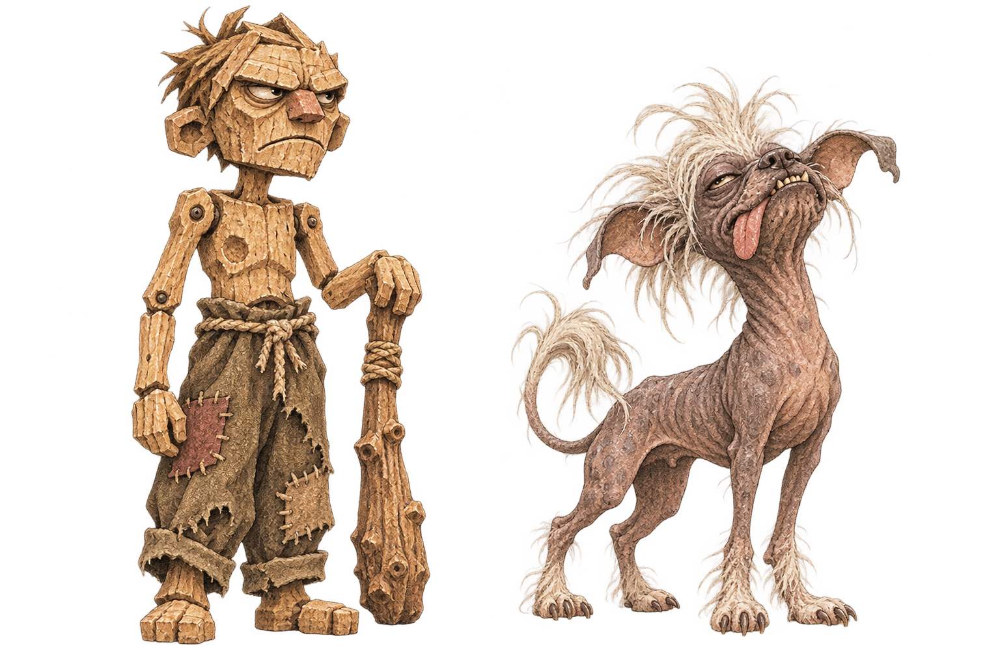

# Sispéo

## Description et personnalité

Provocateur, renfrogné et volontiers vulgaire. Sait communiquer avec les animaux.

## Histoire personnelle

Originaire du bois de Bologne selon le chapitre IV. Marionnette en bois de vétille, de fabrication approximative.

## Évolution pendant la campagne

- **CH_01** : Avec Psodia, entre au bal par les cuisines. Sa marraine les transforme en humains : Sispéo devient un magnifique jeune homme mais conserve sa voix éraillée et sa vulgarité. Reconnaissance et réplique « Mais si, c'est moi ! Tu ne me reconnais pas, trou du cul ? » **reconstituées**, non attestées mot pour mot (Q108). Intervient dans le destin de l’Agneau Unique.
- **CH_02** : Ne souhaite pas aider les habitants dans le cadre de la mission du pèlerinage, contrairement à Psodia (Q205).
- **CH_03** : Répare la cale de La Brigantine.
- **CH_04** : Interprète les paroles du cochon au Domaine des Vieux.
- **CH_05 — Pandosia et le Liber Vetillæ** : Lors de la détention à l'Académie de Sibara, descelle quelques pierres du mur de la cellule. Ces pierres servent de diversion lors de l'évasion organisée par les Canailles ; elles s'échappent par les portes, et non par le mur. Humus conseille de consulter sa marraine, Belle-Mère la Bonne Fée, ou Ondine au sujet de la lignification. Sispéo accompagne l'expédition à Pandosia ; combat les golems tandis que Psodia polit la statuette, puis participe à l'affrontement collectif contre les cinq elfes (Q515).
- **Suite — souvenir à recouper** : Peut diriger les marionnettes géantes elfiques.

## Références visuelles

## Description graphique

Marionnette vivante en bois de vétille brut, mal dégrossie, asymétrique, traces de taille et éclats, articulations apparentes. Menuisier manifestement inachevé. Uniquement un pantalon grossier rapiécé tenu par une corde, pieds de bois nus, aucun chapeau, cape ou chemise. Visage renfrogné, ne sourit jamais. Gourdin rustique long comme son bras. Druide.

## Prompt graphique de référence

Illustration originale de fantasy picaresque italienne, encre fine expressive et aquarelle texturée, rendu artisanal semi-réaliste, détails de matières, vêtements usés, couleurs sourdes (encre #30261F, bordeaux #843A32, olive #546047, or ancien #AC8949). Respecter strictement la planche validée jointe : visage, silhouette, costume et accessoires. Portrait en pied, personnage isolé, fond réellement transparent, sans décor, texte ni cadre. Ne pas embellir ou moderniser le personnage. Marionnette vivante en bois de vétille brut, mal dégrossie, asymétrique, traces de taille et éclats, articulations apparentes. Menuisier manifestement inachevé. Uniquement un pantalon grossier rapiécé tenu par une corde, pieds de bois nus, aucun chapeau, cape ou chemise. Visage renfrogné, ne sourit jamais. Gourdin rustique long comme son bras. Druide.

## Variantes et continuité

Apparence humaine au bal : magnifique jeune homme à la voix éraillée et aux manières grossières, variante narrative à illustrer. Ne pas ajouter de chemise, cape ni chapeau à la tenue canonique.

## Sources et validation

- Référentiel narratif : [RECIT_02_Personnages.md](../../Narration/RECIT_02_Personnages.md).
- Prompt récupéré sur GitHub : `01_Referentiel/Graphisme/prompts/pj/PJ_SISPEO_PROMPT.txt` (emplacement au 25/11/2026).
- Bible graphique GRAPH_02, V1.0, 25/11/2026.
- [Chapitre V, partie 1](../../../02_Manuscrits/Trames/CH5_chapitre5_Pandosia_partie_1_trame.md) et [partie 2](../../../02_Manuscrits/Trames/CH5_chapitre_05_Pandosia_partie_2_trame.md) ; [chronologie narrative](../../Narration/RECIT_01_Chronologie.md).
- Fiche de travail actualisée au 25 novembre 2026 ; les événements ultérieurs au chapitre V restent provisoires. Le nom canonique est exclusivement Sispéo, conformément à la correction de l'utilisateur. Les identifiants des PNJ hors de cette série sont proposés, à créer ou confirmer.
