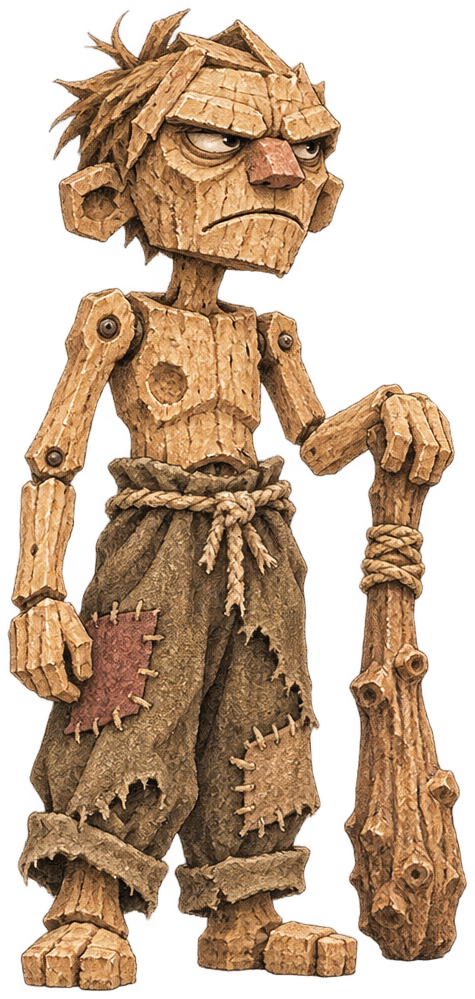

# Sispéo

## Description et personnalité

Également appelé C3PO. Provocateur, renfrogné et volontiers vulgaire. Sait communiquer avec les animaux.

## Histoire personnelle

Originaire du bois de Bologne selon le chapitre IV. Marionnette en bois de vétille, de fabrication approximative.

## Évolution pendant la campagne

- **CH_01** : Sa marraine transforme temporairement Psodia et lui en humains ; intervient dans le destin de l’Agneau Unique.
- **CH_03** : Répare la cale de La Brigantine.
- **CH_04** : Interprète les paroles du cochon au Domaine des Vieux.
- **Suite — souvenir à recouper** : Peut diriger les marionnettes géantes elfiques.

## Références visuelles

## Description graphique

Marionnette vivante en bois de vétille brut, mal dégrossie, asymétrique, traces de taille et éclats, articulations apparentes. Menuisier manifestement inachevé. Uniquement un pantalon grossier rapiécé tenu par une corde, pieds de bois nus, aucun chapeau, cape ou chemise. Visage renfrogné, ne sourit jamais. Gourdin rustique long comme son bras. Druide.

## Prompt graphique de référence

Illustration originale de fantasy picaresque italienne, encre fine expressive et aquarelle texturée, rendu artisanal semi-réaliste, détails de matières, vêtements usés, couleurs sourdes (encre #30261F, bordeaux #843A32, olive #546047, or ancien #AC8949). Respecter strictement la planche validée jointe : visage, silhouette, costume et accessoires. Portrait en pied, personnage isolé, fond réellement transparent, sans décor, texte ni cadre. Ne pas embellir ou moderniser le personnage. Marionnette vivante en bois de vétille brut, mal dégrossie, asymétrique, traces de taille et éclats, articulations apparentes. Menuisier manifestement inachevé. Uniquement un pantalon grossier rapiécé tenu par une corde, pieds de bois nus, aucun chapeau, cape ou chemise. Visage renfrogné, ne sourit jamais. Gourdin rustique long comme son bras. Druide.

## Variantes et continuité

Apparence humaine au bal : variante narrative à illustrer. Ne pas ajouter de chemise, cape ni chapeau à la tenue canonique.

## Sources et validation

- Référentiel narratif : [RECIT_02_Personnages.md](../../Narration/RECIT_02_Personnages.md).
- Prompt récupéré sur GitHub : `01_Referentiel/Graphisme/prompts/pj/PJ_SISPEO_PROMPT.txt` (emplacement au 25/11/2026).
- Bible graphique GRAPH_02, V1.0, 25/11/2026.
- Fiche de travail à valider ; les événements ultérieurs au chapitre IV restent provisoires. Les identifiants des PNJ hors de cette série sont proposés, à créer ou confirmer.
