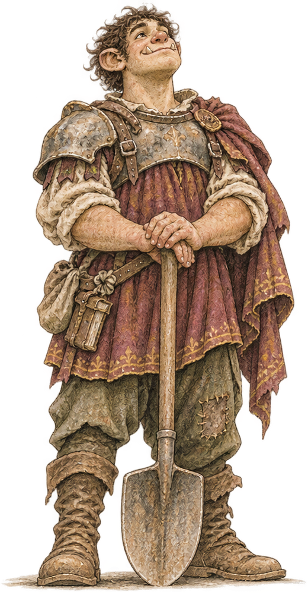

# Tito

## Description et personnalité

Jeune ogre loyal, sincère et attaché à l’ordre. Initialement pris pour un Morgant. Proche de Psodia, avec qui il partage sa roulotte.

## Histoire personnelle

Origine non précisée. Sa mère est la patronne de Chez Gargantua ; les soupçons formulés à son sujet ne sont pas des faits établis.

## Évolution pendant la campagne

- **CH_01** : Acquiert la pelle de Chaterpillar dans la crypte.
- **CH_02** : Rencontre Ondine et révèle sa nature d’ogre.
- **CH_04** : Retrouve sa mère ; divergence avec la clique à propos du Domaine des Vieux.
- **Suite — souvenir à recouper** : Petit Poucet apporte un éclairage sur son histoire familiale ; transformation naine temporaire.

## Références visuelles

## Description graphique

Jeune ogre paladin, massif, visage juvénile, cheveux bruns bouclés, grandes oreilles, petites défenses, regard sincère et fier. Armure métallique patinée, tunique claire, étoffes bordeaux et olive, bottes. Pelle de Chaterpillar après sa découverte à Sourcemolle. Au début environ 2 m ; ensuite environ 2,50 m, même armure devenue trop courte. Variante naine temporaire à créer.

## Prompt graphique de référence

Illustration originale de fantasy picaresque italienne, encre fine expressive et aquarelle texturée, rendu artisanal semi-réaliste, détails de matières, vêtements usés, couleurs sourdes (encre #30261F, bordeaux #843A32, olive #546047, or ancien #AC8949). Respecter strictement la planche validée jointe : visage, silhouette, costume et accessoires. Portrait en pied, personnage isolé, fond réellement transparent, sans décor, texte ni cadre. Ne pas embellir ou moderniser le personnage. Jeune ogre paladin, massif, visage juvénile, cheveux bruns bouclés, grandes oreilles, petites défenses, regard sincère et fier. Armure métallique patinée, tunique claire, étoffes bordeaux et olive, bottes. Pelle de Chaterpillar après sa découverte à Sourcemolle. Au début environ 2 m ; ensuite environ 2,50 m, même armure devenue trop courte. Variante naine temporaire à créer.

## Variantes et continuité

Croissance : 200 à 250 cm. Conserver la même armure, devenue trop courte. Variante naine à créer. Ne pas anticiper l’acquisition de la pelle.

## Sources et validation

- Référentiel narratif : [RECIT_02_Personnages.md](../../Narration/RECIT_02_Personnages.md).
- Prompt récupéré sur GitHub : `01_Referentiel/Graphisme/prompts/pj/PJ_TITO_PROMPT.txt` (emplacement au 25/11/2026).
- Bible graphique GRAPH_02, V1.0, 25/11/2026.
- Fiche de travail à valider ; les événements ultérieurs au chapitre IV restent provisoires. Les identifiants des PNJ hors de cette série sont proposés, à créer ou confirmer.
