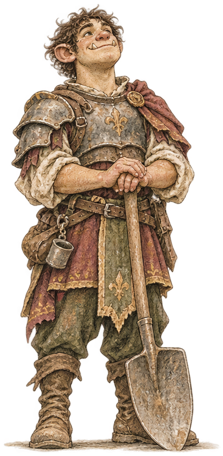
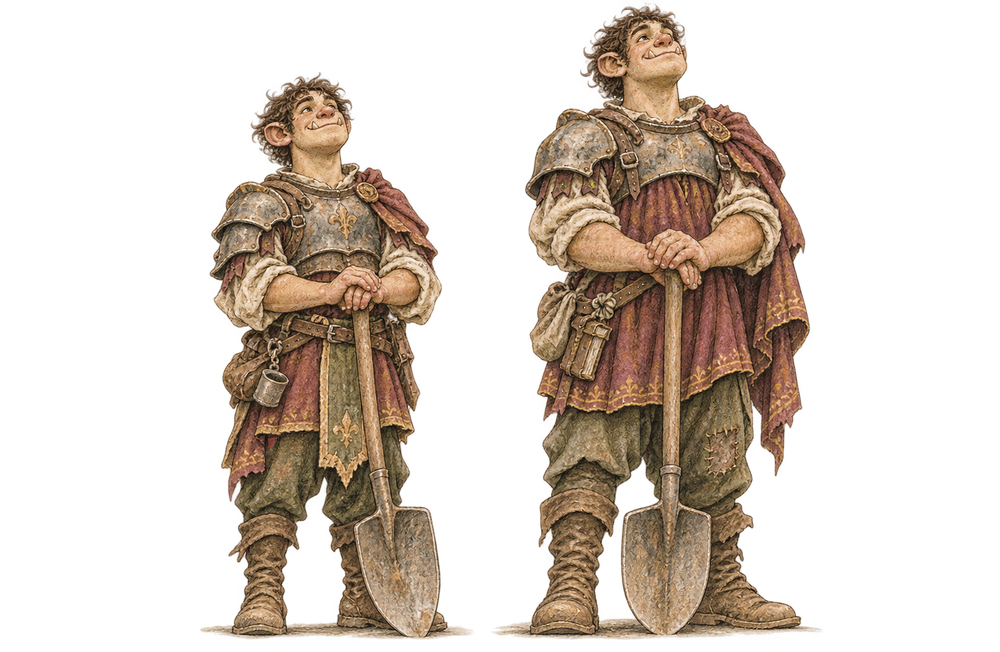

# Tito

## Description et personnalité

Jeune ogre loyal, sincère et attaché à l’ordre. Initialement pris pour un Morgant. Proche de Psodia, avec qui il partage sa roulotte. Ne sachant pas lire, il contribue néanmoins aux recherches universitaires de manière inattendue au chapitre V. Sa force physique est également précieuse à la clique, notamment dans les geôles de Sibara.

## Histoire personnelle

Origine non précisée. Sa mère est la patronne de Chez Gargantua ; les soupçons formulés à son sujet ne sont pas des faits établis.

## Évolution pendant la campagne

- **CH_01** : Acquiert la pelle de Chaterpillar dans la crypte.
- **CH_02** : Rencontre Ondine et révèle sa nature d’ogre.
- **CH_04** : Retrouve sa mère ; divergence avec la clique à propos du Domaine des Vieux.
- **CH_05 — La cabane du savoir** : Pendant les recherches à la bibliothèque de l'Académie, s'ennuie et construit une cabane avec les livres. En ouvrant un grand volume pour former le toit, une réussite critique lui permet de reconnaître une illustration de Chez Gargantua. Il découvre ainsi que le restaurant aurait été construit sur l'ancien temple de la Faim Rassasiée et que la marmite de Saint Glaude y figurait comme relique magique. Cette découverte fait avancer la quête de Marée de Nuit.
- **CH_05 — Les geôles de Sibara** : Après la dénonciation de Hulc, est emprisonné avec les Canailles. Contribue largement à leur victoire lors de la bagarre avec les malfrats de la cellule ; la clique devient la nouvelle bande dominante de la cellule.
- **CH_05 — Retrouvailles avec Ondine** : Après l'évasion, retrouve Ondine à bord de la péniche, pour son plus grand bonheur. La fée apporte des indications qui ravivent les souvenirs de Psodia.
- **CH_05 — Expédition dans les égouts** : Remarque une étrange masse noire accrochée au plafond, le Tas de boue qui attaque les Canailles. Participe ensuite à l'expédition à Pandosia et à la libération de Quenotte avec ses compagnons. Son rôle précis dans les combats et le polissage n'est pas établi.
- **CH_06 — Suite à documenter** : Petit Poucet apporte un éclairage sur son histoire familiale ; transformation naine temporaire lors de l'arc culinaire, selon les souvenirs à recouper. Ne pas anticiper ces révélations au V.

## Références visuelles

## Description graphique

Jeune ogre paladin, massif, visage juvénile, cheveux bruns bouclés, grandes oreilles, petites défenses, regard sincère et fier. Armure métallique patinée, tunique claire, étoffes bordeaux et olive, bottes. Pelle de Chaterpillar après sa découverte à Sourcemolle. Au début environ 2 m ; ensuite environ 2,50 m, même armure devenue trop courte. Variante naine temporaire à créer.

## Prompt graphique de référence

Illustration originale de fantasy picaresque italienne, encre fine expressive et aquarelle texturée, rendu artisanal semi-réaliste, détails de matières, vêtements usés, couleurs sourdes (encre #30261F, bordeaux #843A32, olive #546047, or ancien #AC8949). Respecter strictement la planche validée jointe : visage, silhouette, costume et accessoires. Portrait en pied, personnage isolé, fond réellement transparent, sans décor, texte ni cadre. Ne pas embellir ou moderniser le personnage. Jeune ogre paladin, massif, visage juvénile, cheveux bruns bouclés, grandes oreilles, petites défenses, regard sincère et fier. Armure métallique patinée, tunique claire, étoffes bordeaux et olive, bottes. Pelle de Chaterpillar après sa découverte à Sourcemolle. Au début environ 2 m ; ensuite environ 2,50 m, même armure devenue trop courte. Variante naine temporaire à créer.

## Variantes et continuité

Croissance : 200 à 250 cm. Conserver la même armure, devenue trop courte. Le moment exact de la croissance n'est pas fixé dans cette fiche : vérifier la taille de Tito pour chaque scène du chapitre V à partir de la chronologie et des références validées. Ne pas anticiper l’acquisition de la pelle.

- **Déguisement universitaire (CH_05)** : fausse barbe et robe de mage, variante proposée à partir du déguisement collectif ; conserver sa silhouette massive et ses traits juvéniles. Ajustement précis du costume à valider.
- **Cabane de livres (CH_05)** : mettre en valeur le contraste entre sa taille et son assemblage de volumes ; le grand livre ouvert forme le toit. Ne pas présenter Tito comme sachant lire.
- **Retrouvailles avec Ondine (CH_05)** : respecter les références des deux personnages et leur différence d'échelle ; joie de Tito attestée, réciprocité amoureuse non établie par cette scène.
- **Variante naine temporaire (CH_06)** : à créer ou valider dans le cadre de l'arc Croc Chef ; ne pas l'utiliser au chapitre V.

## Sources et validation

- Référentiel narratif : [RECIT_02_Personnages.md](../../Narration/RECIT_02_Personnages.md).
- Prompt récupéré sur GitHub : `01_Referentiel/Graphisme/prompts/pj/PJ_TITO_PROMPT.txt` (emplacement au 25/11/2026).
- Bible graphique GRAPH_02, V1.0, 25/11/2026.
- [Chapitre V, partie 1](../../../02_Manuscrits/Trames/CH5_chapitre5_Pandosia_partie_1_trame.md) et [partie 2](../../../02_Manuscrits/Trames/CH5_chapitre_05_Pandosia_partie_2_trame.md) ; [chronologie](../../Narration/RECIT_01_Chronologie.md) ; [registre des illustrations](../../Graphisme/GRAPH_05_Prompts_CH05_Pandosia.md).
- Fiche actualisée au 25 novembre 2026, à valider ; les événements ultérieurs au chapitre V restent provisoires. Les PDF du MJ n'ont pas été relus pour cette mise à jour. Les identifiants des PNJ hors de cette série sont proposés, à créer ou confirmer.
