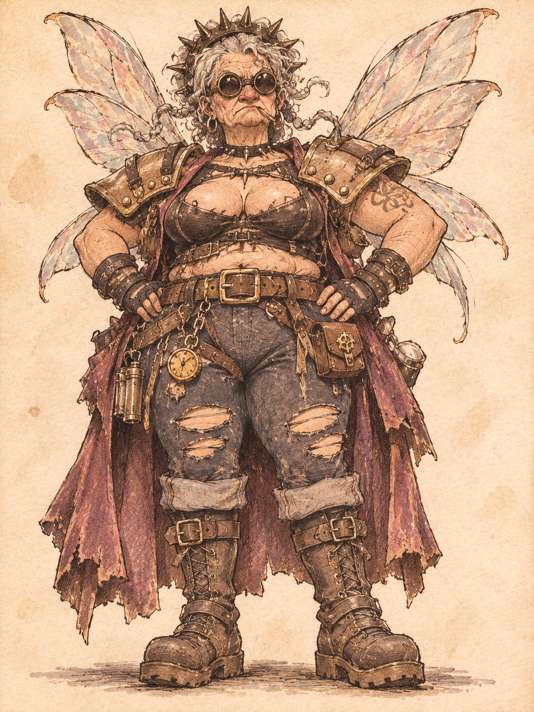

# Carabosse

## Description et personnalité

Fée acariâtre, à l'allure de motarde rebelle. Elle se distingue des autres fées par son style punk-steampunk, son tempérament peu commode et son balai-moto (souvenirs de campagne à documenter).

## Histoire personnelle

Origine, âge exact et passé inconnus. Le référentiel narratif emploie la graphie Carrabsosse ; Carabosse est la graphie employée par l'autrice dans les échanges récents.

## Évolution pendant la campagne

- **Arc du concours Croc Chef (suite du chapitre V, provisoire)** : associée à la transformation de Tito en nain. Les circonstances précises et la première apparition restent à documenter dans les trames ultérieures.

## Références visuelles

Portrait retravaillé et validé par l'autrice le 25/11/2026 ; fichier présent dans Git.

## Description graphique

Fée âgée et corpulente, silhouette massive, visage profondément ridé et renfrogné, cheveux gris bouclés avec petites tresses, lunettes rondes fumées, diadème et collier à pointes, grandes boucles d'oreilles. Grandes ailes translucides nervurées aux reflets irisés.

Tenue de motarde punk-steampunk : épaulettes rigides rivetées, corsage court en cuir brun, ceintures et sangles à boucles, mitaines, pantalon gris déchiré, grosses bottes lacées et bouclées, long manteau bordeaux violacé aux bords effilochés. Chaînes, sacoches, montre et accessoires métalliques en laiton vieilli. Tatouage et cigarette visibles sur le portrait validé. Attitude campée, mains sur les hanches et expression rébarbative.

## Prompt graphique de référence

Illustration originale de fantasy picaresque italienne, encre fine expressive et aquarelle texturée, rendu artisanal semi-réaliste, détails de matières et vêtements usés. Respecter le portrait validé : fée âgée et corpulente, visage ridé renfrogné, cheveux gris bouclés et tressés, lunettes rondes fumées, diadème et collier à pointes, ailes translucides irisées. Tenue de motarde punk-steampunk, cuir brun patiné, épaulettes rivetées, corsage court, ceintures et sangles, pantalon gris déchiré, grosses bottes, manteau bordeaux violacé effiloché, accessoires en laiton. Ne pas rajeunir, amincir ou embellir le personnage. Pour la référence technique : portrait en pied, personnage isolé, fond transparent, sans texte ni cadre.

## Variantes et continuité

- Portrait de présentation : conserver le portrait approuvé, sur papier texturé.
- Référence technique isolée : à produire si nécessaire.
- Carabosse sur son balai-moto : illustration à produire ; conception mécanique steampunk à définir et valider.
- Préserver le contraste avec Tourette (baroque), Ondine (Art nouveau) et Nuance (marine).
- Ne pas transformer les accessoires graphiques du portrait en objets magiques attestés.

## Sources et validation

- [RECIT_02_Personnages.md](../../Narration/RECIT_02_Personnages.md), entrée Carrabsosse.
- Souvenirs de campagne concernant le balai-moto et la transformation temporaire de Tito.
- Croquis steampunk fourni par l'autrice, puis retravaillé pour vieillir et étoffer la silhouette.
- Portrait approuvé par l'autrice le 25/11/2026.

Identité graphique validée ; portrait déposé dans Git. Illustration du balai-moto à effectuer. Fiche narrative provisoire, faute de trame détaillée du concours. Identifiant PNJ_CARABOSSE et statut portrait_valide proposés.
