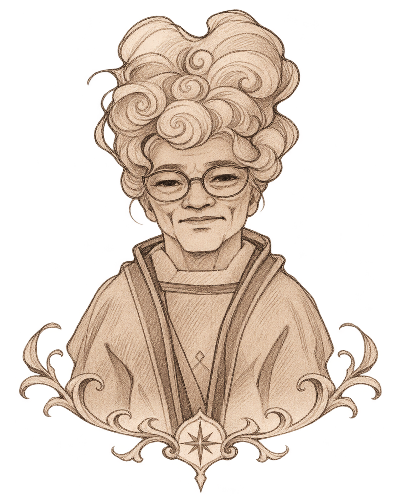

# Dame Mystique

## Description et personnalité

Condottière reconnaissable à ses énormes lunettes et à son caractère affirmé.

Elle dirige une compagnie itinérante de Canailles, installée dans un campement de roulottes.

Elle possède une solide connaissance du monde universitaire et des affaires magiques.

## Histoire personnelle

De son véritable nom Miranda Zardélia, Dame Mystique fut autrefois doyenne de l'université de magie de Sibara.

Elle fut démise de ses fonctions à la suite de plusieurs scandales universitaires et financiers relatés dans Le Porte-Malheur :

- Stages de pratique désastreux.
- Bibliothèque vivante.
- Jardins enchantés incontrôlables.
- Élixirs aux effets inattendus.

Dans sa jeunesse, elle entretint une relation amoureuse avec Louis, aujourd'hui bibliothécaire de l'université.

## Évolution pendant la campagne

- **CH_01** : Dirige le campement itinérant auquel appartiennent les cinq Canailles.
- **CH_02** : Envoie la clique en mission à Scanzona.
- **CH_05** : Son véritable nom et son passé universitaire sont révélés par Louis.
- **CH_05** : Formule l'hypothèse que les elfes cherchent à emprisonner les fées grâce au bois de vétille.
- **CH_05** : Soupçonne le guiscard Destin de craindre la vengeance de Tarantasio.

Ces deux dernières interprétations restent des hypothèses du personnage.

## Références visuelles

Portrait définitif à produire.

## Description graphique

Femme reconnaissable à ses très grandes lunettes.

L'apparence complète, la silhouette, la coiffure, le costume et les accessoires devront être précisés à partir du croquis original.

## Prompt graphique de référence

Illustration originale de fantasy picaresque italienne, encre fine expressive et aquarelle texturée, rendu artisanal semi-réaliste, détails de matières, vêtements usés, couleurs sourdes (encre #30261F, bordeaux #843A32, olive #546047, or ancien #AC8949).

Portrait en pied, personnage isolé, fond réellement transparent, sans décor, texte ni cadre.

Condottière reconnaissable à ses très grandes lunettes. S'appuyer sur le croquis original de Dame Mystique pour définir son apparence.

Ne pas embellir ou moderniser le personnage.

Prompt provisoire, à compléter après validation de la description graphique.

## Variantes et continuité

- Conserver les très grandes lunettes dans toutes les représentations.
- Ne pas révéler son identité de Miranda Zardélia avant le chapitre V dans le récit.
- Aucune variante graphique validée.

## Sources et validation

- RECIT_02_Personnages.md.
- RECIT_01_Chronologie.md.
- CH01_chapitre01_Sourcemolle_trame.md.
- CH5_chapitre5_Pandosia_partie_1_trame.md.
- GRAPH_05_Prompts_CH01_Sourcemolle.md.
- Croquis original : dame_mystique.png.

Contenu narratif et fiche de travail approuvés le 25/11/2026 ; description graphique et portrait définitif à valider.
Identifiant PNJ_MUSTRUM proposé.
