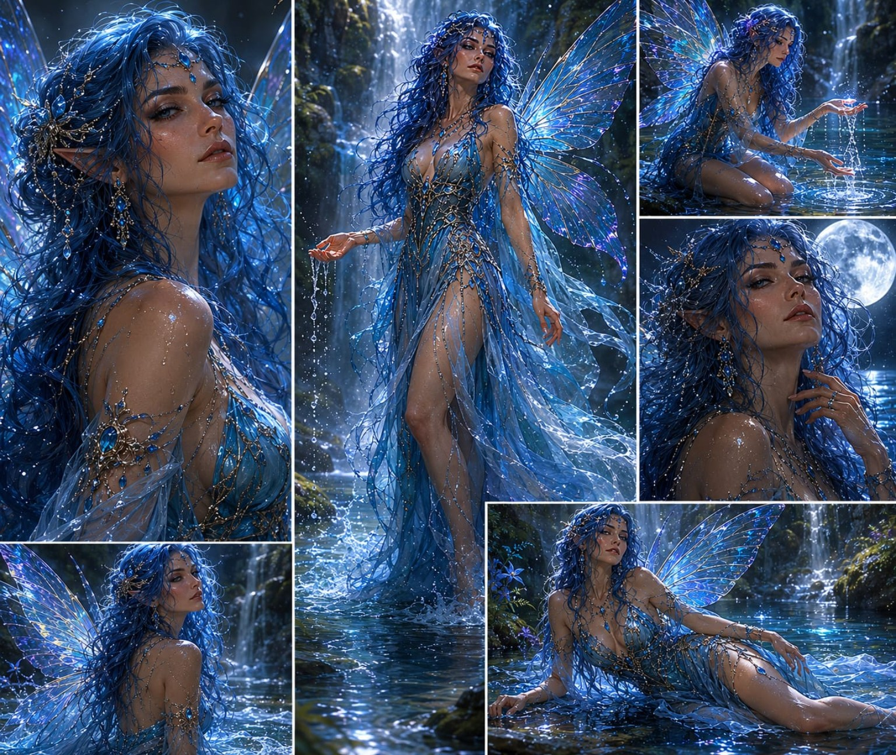

# Ondine

## Description et personnalité

Magnifique fée des eaux, alliée boudeuse mais précieuse de la clique. Elle soutient la faction des fées favorable au rétablissement de l'ordre dans la magie et les contes. Ses motivations ne sont pas toujours explicites. Tito tombe immédiatement amoureux d'elle ; la réciprocité de cet amour reste à préciser.

## Histoire personnelle

Origine et passé personnel inconnus. Ondine connaît les enjeux de la guerre des fées, dite guerre de Sausisson, et rapporte le réveil de Tarantasio, la déchirure de la trame magique et la disparition de l'Enfant, reine des fées. La chronologie exacte de ces événements reste à confirmer. Sydney, nom proposé pour la cheffe des fées légalistes, n'est pas un nom définitivement établi.

## Évolution pendant la campagne

- **CH_02 (II.04)** : Secourue par les Canailles alors qu'elle est accusée d'être une sorcière, elle révèle sa nature de fée des eaux. Tito tombe amoureux d'elle. Elle explique les enjeux de la guerre des fées.
- **CH_02 (II.07)** : Retrouvée grâce à Perdita dans un cours d'eau, en plein affrontement avec de grands guerriers. Elle remercie les Canailles et rejoint la clique.
- **CH_04 (IV.12)** : Demande de soutenir les trois entrepreneurs cochons contre le Loup. Ses raisons demeurent inconnues de la clique ; son intervention provoque un désaccord.
- **CH_05 (V.10)** : Humus conseille de la consulter au sujet de la lignification.
- **CH_05 (V.15)** : Retrouvée sur la péniche après l'évasion. Elle indique qu'une fée se trouverait dans les égouts de Sibara et suggère que Quenotte pourrait connaître le sort de l'Enfant.

## Références visuelles

La planche existante sert de référence d'identité physique et de couleurs, non de modèle stylistique définitif. Nouveau portrait de présentation à produire.

## Description graphique

Longue chevelure bleu profond, abondante et ondulante, visage délicat aux traits réguliers, oreilles pointues, grandes ailes translucides nervurées aux reflets bleus. Silhouette élancée, robe fluide bleue évoquant l'eau, ornements dorés et bijoux délicats sertis de pierres bleues. Expression distante, majestueuse, légèrement boudeuse. Taille exacte et couleur des yeux non confirmées.

## Prompt graphique de référence

### Portrait éditorial de présentation

Illustration originale inspirée de l'Art nouveau d'Alfons Mucha et de la grâce Renaissance de Botticelli, notamment la Vénus. Composition verticale de panneau décoratif, personnage en pied, lignes fines et sinueuses, aplats délicatement nuancés, texture de papier et rendu artisanal. Préserver les traits et l'identité chromatique de la référence PNJ_ONDINE.jpg. Longue chevelure bleu outremer dessinant des arabesques aquatiques, visage délicat à l'expression distante et légèrement boudeuse, oreilles pointues, grandes ailes translucides évoquant des vitraux Art nouveau, robe fluide et drapés inspirés de l'eau, bijoux stylisés en or ancien et pierres bleues. Palette outremer, turquoise, ivoire et or ancien. Motifs aquatiques et végétaux ornementaux, composition élégante, beauté mystérieuse et hiératique plutôt que pose séductrice. Sans texte. Éviter le photoréalisme numérique, les effets de paillettes et l'esthétique fantasy brillante de la planche initiale.

### Référence pour les scènes narratives

Illustration originale de fantasy picaresque italienne, encre fine expressive et aquarelle texturée, rendu artisanal semi-réaliste conforme à la charte graphique commune. Conserver le visage, la silhouette, la chevelure bleue, les ailes, la robe et les ornements d'Ondine. Adapter le traitement graphique à celui des autres personnages et du décor, sans imposer le cadre décoratif ou la composition d'affiche Art nouveau aux scènes collectives.

## Variantes et continuité

- Portrait éditorial : traitement spécifique Mucha–Botticelli, direction approuvée par l'autrice ; illustration à produire et valider.
- Scènes narratives : harmonisation avec la bible graphique commune tout en conservant l'identité physique d'Ondine.
- Ne pas révéler ses motivations cachées ni supposer la réciprocité des sentiments de Tito.
- Ne pas confondre direction stylistique individuelle et modification de la charte générale du recueil.

## Sources et validation

- [RECIT_02_Personnages.md](../../Narration/RECIT_02_Personnages.md).
- [RECIT_01_Chronologie.md](../../Narration/RECIT_01_Chronologie.md).
- Trames des chapitres II (Scanzona), IV (Vétille) et V (Pandosia).
- Référence PNJ_ONDINE.jpg fournie et confirmée par l'autrice.
- Direction artistique du portrait de présentation Mucha–Botticelli validée par l'autrice le 25/11/2026.

Fiche narrative à relire. Portrait et traitement des scènes à valider après réalisation. Le type alliee, le champ inspiration et les identifiants PNJ_PERDITA et PNJ_QUENOTTE sont proposés.
