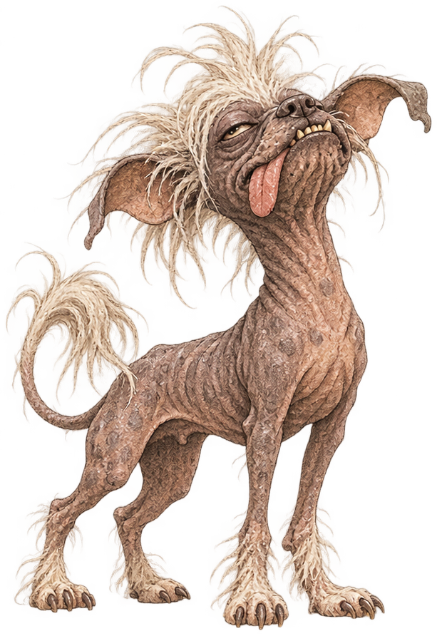
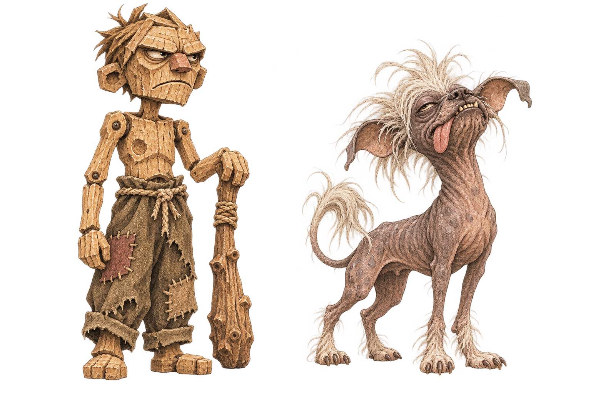

# Sultan

## Description et personnalité

Chien persuadé d’être un lion. Attitude fière et royale malgré son apparence singulière.

## Histoire personnelle

Origine inconnue.

## Évolution pendant la campagne

- **CH_01** : Accompagne Sispéo dès le début du récit.

## Références visuelles

## Description graphique

Chien presque nu inspiré des chiens chinois à crête du concours du chien le plus moche du monde : peau ridée, touffes de poils clairs éparses, grandes oreilles irrégulières, dents de travers, langue pendante. Port de tête fier et attitude royale : il se croit un lion. Ni crinière de lion, ni cape, ni couronne.

## Prompt graphique de référence

Illustration originale de fantasy picaresque italienne, encre fine expressive et aquarelle texturée, rendu artisanal semi-réaliste, détails de matières, vêtements usés, couleurs sourdes (encre #30261F, bordeaux #843A32, olive #546047, or ancien #AC8949). Respecter strictement la planche validée jointe : visage, silhouette, costume et accessoires. Portrait en pied, personnage isolé, fond réellement transparent, sans décor, texte ni cadre. Ne pas embellir ou moderniser le personnage. Chien presque nu inspiré des chiens chinois à crête du concours du chien le plus moche du monde : peau ridée, touffes de poils clairs éparses, grandes oreilles irrégulières, dents de travers, langue pendante. Port de tête fier et attitude royale : il se croit un lion. Ni crinière de lion, ni cape, ni couronne.

## Variantes et continuité

Aucune variante renseignée. Taille exacte à confirmer.

## Sources et validation

- Référentiel narratif : [RECIT_02_Personnages.md](../../Narration/RECIT_02_Personnages.md).
- Prompt récupéré sur GitHub : `01_Referentiel/Graphisme/prompts/pnj/PNJ_SULTAN_PROMPT.txt` (emplacement au 25/11/2026).
- Bible graphique GRAPH_02, V1.0, 25/11/2026.
- Fiche de travail à valider ; les événements ultérieurs au chapitre IV restent provisoires. Les identifiants des PNJ hors de cette série sont proposés, à créer ou confirmer.
