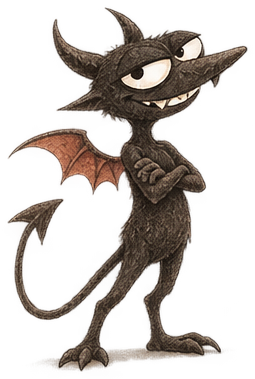
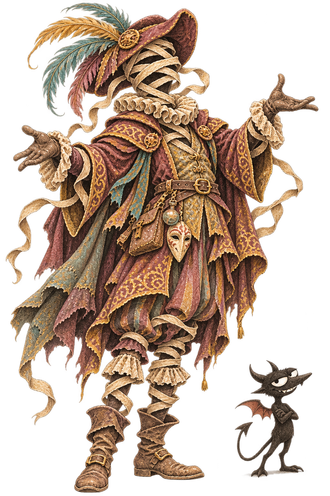

# Truffino

## Description et personnalité

Petit diablotin sarcastique, familier magique de Personne.

## Histoire personnelle

Origine inconnue.

## Évolution pendant la campagne

- **CH_02** : Alerte Personne sur le danger menaçant la péniche.
- **CH_04** : Mis hors de combat chez Gargantua ; peut être rappelé ultérieurement.

## Références visuelles

## Description graphique

Petit diablotin noir, silhouette fine et caricaturale, grandes oreilles pointues, petites cornes, ailes de chauve-souris, queue en pointe, yeux blancs expressifs, sourire sarcastique. Inspiré du petit démon de Désenchantée, mais conserver la référence validée et le traitement graphique du recueil.

## Prompt graphique de référence

Illustration originale de fantasy picaresque italienne, encre fine expressive et aquarelle texturée, rendu artisanal semi-réaliste, détails de matières, vêtements usés, couleurs sourdes (encre #30261F, bordeaux #843A32, olive #546047, or ancien #AC8949). Respecter strictement la planche validée jointe : visage, silhouette, costume et accessoires. Portrait en pied, personnage isolé, fond réellement transparent, sans décor, texte ni cadre. Ne pas embellir ou moderniser le personnage. Petit diablotin noir, silhouette fine et caricaturale, grandes oreilles pointues, petites cornes, ailes de chauve-souris, queue en pointe, yeux blancs expressifs, sourire sarcastique. Inspiré du petit démon de Désenchantée, mais conserver la référence validée et le traitement graphique du recueil.

## Variantes et continuité

Aucune variante renseignée. Taille exacte à confirmer.

## Sources et validation

- Référentiel narratif : [RECIT_02_Personnages.md](../../Narration/RECIT_02_Personnages.md).
- Prompt récupéré sur GitHub : `01_Referentiel/Graphisme/prompts/pnj/PNJ_TRUFFINO_PROMPT.txt` (emplacement au 25/11/2026).
- Bible graphique GRAPH_02, V1.0, 25/11/2026.
- Fiche de travail à valider ; les événements ultérieurs au chapitre IV restent provisoires. Les identifiants des PNJ hors de cette série sont proposés, à créer ou confirmer.
